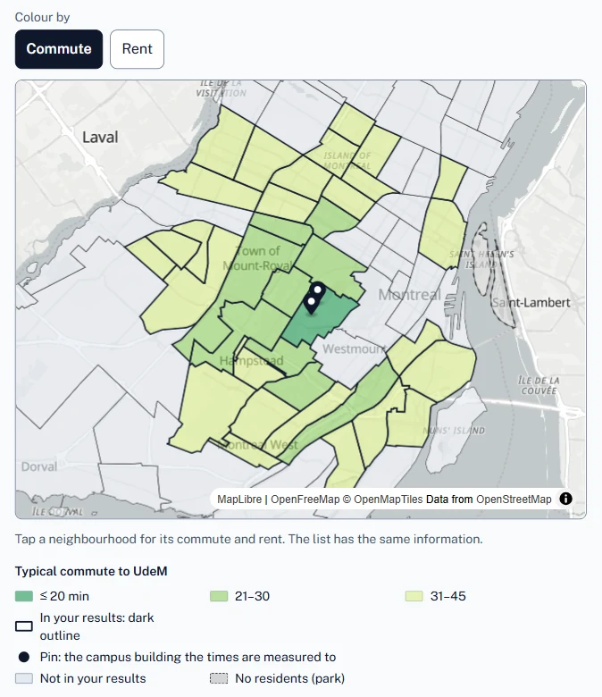

# Montréal Without a Car (working title)

**Find where to live in Montréal without a car:** a bilingual web app that ranks Montréal
neighbourhoods for students by transit commute to their campus and by estimated rent, built
entirely from open data.

**Status: launching January 2027.**

Built with Claude Code as a coding assistant; I set the rules, made the decisions, and reviewed
and merged every PR.



*Map view for UdeM, a 3½ (one bedroom) up to $1,500 a month and at most 45 minutes: the
darker the green, the shorter the typical commute.*

## What it does

Pick your campus (UdeM, McGill, Concordia SGW), size (room / studio / 3½ / 4½), an optional
budget and a maximum transit commute. The site shows:

- a ranked shortlist of neighbourhoods that fit,
- a map of Montréal neighbourhoods coloured by transit commute time or rent, as a second view,
- a detail panel per neighbourhood: commute estimate, rent estimate, data source, date and reliability.

**Data honesty is rule #1.** Every number shows where it comes from, when, and how reliable it is.
When the data is too thin, the site says "not enough data" instead of guessing.
See [DATA_SOURCES.md](DATA_SOURCES.md) and [docs/methodology.md](docs/methodology.md).

## Tech

- **Routing pipeline (Python 3.12):** [r5py](https://r5py.readthedocs.io/) on Conveyal's R5
  engine routes about 3,200 residential sample points (one per census dissemination area,
  weighted by occupied dwellings) to each campus building, over OpenStreetMap streets and the
  STM, REM and exo GTFS schedules. It departs every minute from 7:30 to 8:30 and keeps the
  median per neighbourhood, so waiting for the bus counts. geopandas handles the geography.
- **Rent estimates:** CMHC Rental Market Survey ratios per area, scaled to Statistics Canada's
  citywide asking rent, through a hand-built crosswalk from the city's neighbourhoods to CMHC's
  areas that is checked against CMHC's unit counts.
- **Website:** Next.js 16 (App Router, pages prerendered), React 19, TypeScript, Tailwind CSS 4
  and MapLibre GL. French at `/`, English at `/en`. Page shells are prerendered and the results
  are rendered on the server from precomputed JSON: no database, routing server or accounts.
- **Tests and CI:** pytest (including tests that start the JVM, run locally), Vitest and ruff.
  GitHub Actions runs lint, tests and the production build on every pull request. When the
  export became bilingual, a fingerprint test proved that no published number changed.

## How the commute times were validated

R5's times were compared with Google Maps on hand-picked trips (Tuesday 2026-12-01, arrive
by 8:30). A trip passes if R5's median is within 5 minutes or 15% of Google's, whichever is
larger.

- **UdeM: 6 of 7 transit trips pass** (plus the two platform walks the building-access
  adjustments were calibrated on). The walking speed (4.0 km/h) and those adjustments were
  tuned on these same routes, so this is an in-sample result. The one failure is Google's
  choice of a slower first trip; against the like-for-like trip it passes.
- **McGill: 4 of 5, Concordia: 5 of 5 transit trips**, with the walking speed frozen. The mean
  difference is +0.4 min for both. The McGill failure (+7 min on a REM trip) is explained in
  the report, not tuned away.
- **Still to do before launch:** 3–4 new routes, collected before running R5, will be checked
  with every setting frozen, and failures will be reported as they are.

Full method and results: [pipeline/validation/VALIDATION.md](pipeline/validation/VALIDATION.md).

## Licence

The **code** is under the [MIT licence](LICENSE).

The **data** keeps its own licences: the MIT licence does not cover it. That includes the
files the pipeline publishes in `web/public/data/` and the committed tables in
`pipeline/crosswalk/` and `pipeline/validation/`, which are derived from:

| Data | Publisher | Licence |
|---|---|---|
| Neighbourhood boundaries and dwelling counts | Ville de Montréal | CC BY 4.0 |
| Bus and metro schedules (GTFS) | STM | CC BY 4.0, plus the STM's condition that metro schedules are indicative and may not be used for a metro timetable app ([how we comply](DATA_SOURCES.md#stm-metro-schedule-condition-how-we-comply)) |
| REM schedules (GTFS) | Réseau express métropolitain | CC BY 4.0 |
| Commuter train schedules (GTFS) | exo | CC BY 4.0 |
| Street network | © OpenStreetMap contributors (Geofabrik extract) | ODbL 1.0 |
| Census geography; citywide asking rent | Statistics Canada | Statistics Canada Open Licence |
| Average rents and rental units by area | CMHC | CMHC Licence Agreement for the Use of Data |

The site's basemap is served by OpenFreeMap (© OpenMapTiles, data © OpenStreetMap
contributors), and its font is Public Sans (SIL Open Font License 1.1). The `/qa` and
`/design-review` skills in `.claude/skills/` are adapted from gstack (MIT, © 2026 Garry Tan;
see `.claude/skills/LICENSE-gstack.txt`). The data sources' versions, links and exact credits
are in [DATA_SOURCES.md](DATA_SOURCES.md).

---

# Developer docs

## How it works

```
open data (manual downloads)          offline Python pipeline              static website
data/raw/  ───────────────────────►   pipeline/  (r5py, geopandas)  ──►   web/public/data/*.json
                                                                          web/  (Next.js + MapLibre)
```

Everything is precomputed. There is no routing server, database or account system in production.

## Repository layout

| Path | What |
|---|---|
| `data/` | Downloaded and intermediate data (gitignored) + `manifest.csv` (committed). See [data/README.md](data/README.md). |
| `pipeline/` | Python pipeline: boundaries, sample points, travel times, rent estimates, export. |
| `web/` | Next.js site (from Phase 1.5). Reads static JSON from `web/public/data/`. |
| `docs/` | Methodology and limitations. |

## Run

### Pipeline (Windows)

Prerequisite: [Miniforge](https://github.com/conda-forge/miniforge) (provides `mamba`/`conda`).
The environment brings its own Python 3.12 and OpenJDK 21, so it does not touch your system Java or Python.

Open **Miniforge Prompt** in the repo folder:

```bat
mamba env create -f pipeline\environment.yml
mamba activate mtlhousing
pip install -e pipeline --no-deps
pytest pipeline
```

To update the environment after `environment.yml` changes:

```bat
mamba env update -f pipeline\environment.yml --prune
```

Pipeline steps (run in order, from the repo root, inside the env). Each step caches its output in `data/interim/` and is safe to re-run:

```bat
python -m mtlhousing boundaries      :: quartiers -> data/interim/quartiers.parquet
python -m mtlhousing sample-points   :: StatCan DAs -> residential sample points (first run ~10 s)
python -m mtlhousing osm-clip        :: Québec PBF -> Montréal PBF (~45 s, skipped if unchanged)
python -m mtlhousing gtfs-check      :: feed periods + validates config.ANALYSIS_DATE (exit 1 if not OK)
python -m mtlhousing tunnel-check    :: walk-only check: UdeM metro -> Roger-Gaudry through the tunnel
python -m mtlhousing travel-times --campus udem   :: r5py, ~25 min; JVM capped at 6 GB
python -m mtlhousing travel-times --campus udem --repair-only   :: re-route only homes that reached nothing
python -m mtlhousing aggregate --campus udem      :: per-quartier median/p10/p90, access adjustments, flags
python -m mtlhousing export                       :: web/public/data/*.json(geojson) for every campus with results + check maps
python -m mtlhousing validate --campus udem       :: R5 vs Google routes -> pipeline/validation/udem_results.csv
python -m mtlhousing access-check --campus udem   :: R5 platform -> building walks and the access adjustments they imply
python -m mtlhousing crosswalk-check  :: quartier -> CMHC neighbourhood -> zone, checked against CMHC unit counts (exit 1 on a problem)
python -m mtlhousing rent             :: rent estimate per quartier and bedroom type -> data/interim/rent_by_quartier.csv
python -m mtlhousing rent-export      :: re-checks the crosswalk, rounds to $25 -> web/public/data/rent.json (committed)
```

### Web

Requires Node 22.12+ (Vitest 5; CI uses Node 22). From the repo root:

```bat
cd web
npm ci
npm run dev        :: http://localhost:3000
npm test           :: Vitest: rent classes, commute texts, search parsing, UI strings (web/lib/**/*.test.ts)
```

Pages, in French (the default) and English (M5.3b, owner's M5 decision 7). Each language has
its own paths, listed in `web/lib/routes.ts`; the header's "English" / "Français" link opens the
same page in the other language, keeping the search. There is no automatic redirect.

| Page | French | English |
|---|---|---|
| Search | `/` | `/en` |
| Results | `/resultats` | `/en/results` |
| How it works | `/comment-ca-marche` | `/en/how-it-works` |
| Sources and limitations | `/sources` | `/en/sources` |

The shared page code is in `web/app/_site/`; `web/app/(fr)` and `web/app/(en)` are the two root
layouts and their thin route files. All UI text is in `web/lib/strings/` (`en.ts`, `fr.ts`, same
shape, Québec formats in French); the design system is described in `web/DESIGN.md`.

- Search: the search form (campus, size, optional budget, max commute) and an example search.
- Results: the shortlist. Neighbourhoods within the max commute, grouped by budget (within
  budget / slightly over / not enough data), fastest commute or cheapest rent first; each card
  opens a detail panel (commute range, buildings, rent basis, sources). Rules: `web/lib/shortlist.ts`.
  - `view=map`: the same results on a map (commute or rent colours, the rest greyed with the
    reason in its popup). The list stays the default. Basemap: OpenFreeMap (no API key).
  - `open=<id>`: opens that card (the map popup's "Show details").
  - "Copy link" copies the clean link of the search (no empty `budget=`, no `open=`; `view` and
    `sort` kept), and the address bar shows the same. Link previews are text only: the
    search's own title and description.
- How it works: where the commute times and rents come from, and the shortlist rules.
- Sources and limitations: The known limitations, how the commute times were
  checked against Google Maps, the commute and rent limits, every source with its link, licence
  and date, the credits, and an About block. Its typed facts (`web/lib/sources.ts`) are tested
  against `pipeline/validation/`, `DATA_SOURCES.md` and `data/manifest.csv`.
- Footer on the site's pages: the data line (schedule day, CMHC period, StatCan quarter) and
  links to How it works and Sources.

They read `web/public/data/neighbourhoods.geojson`, `commute.json` and `rent.json` (written by
the pipeline's `export` and `rent-export` steps and committed). Text the site shows from these
files (campus and building names, credits, CMHC's grade words, the crosswalk notes) is written
in both languages as `{"en": ..., "fr": ...}` (M5.3a); `pipeline/tests/test_bilingual_export.py`
checks the bilingual re-export changed no number.

## Status

See [docs/ROADMAP.md](docs/ROADMAP.md).

## Credits

Data sources and required attributions are listed in [DATA_SOURCES.md](DATA_SOURCES.md).
